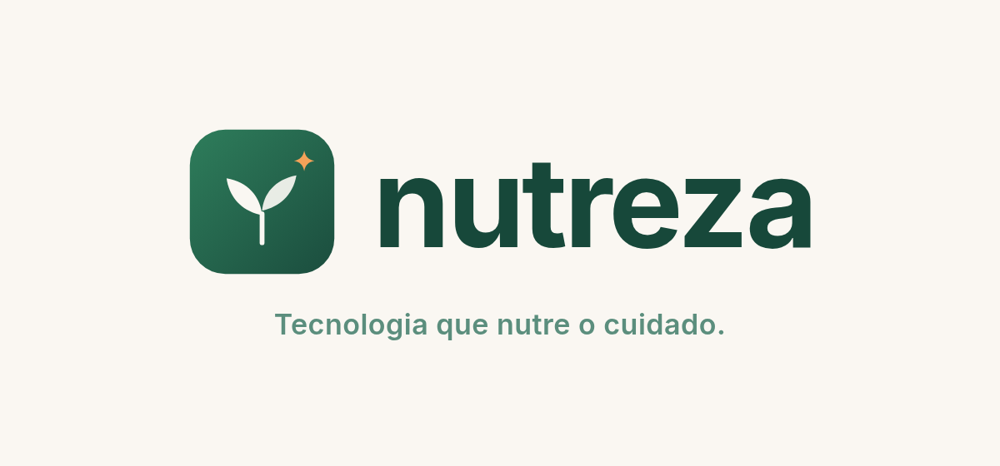
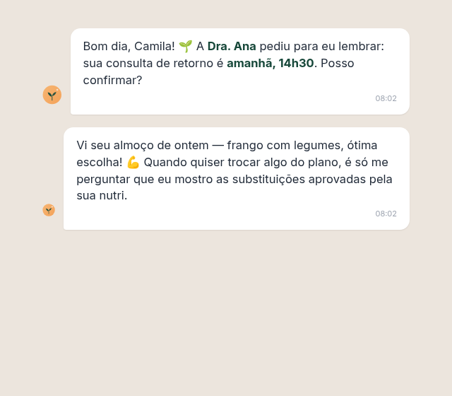
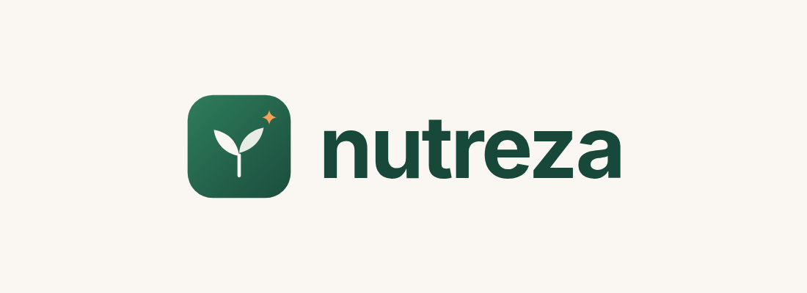
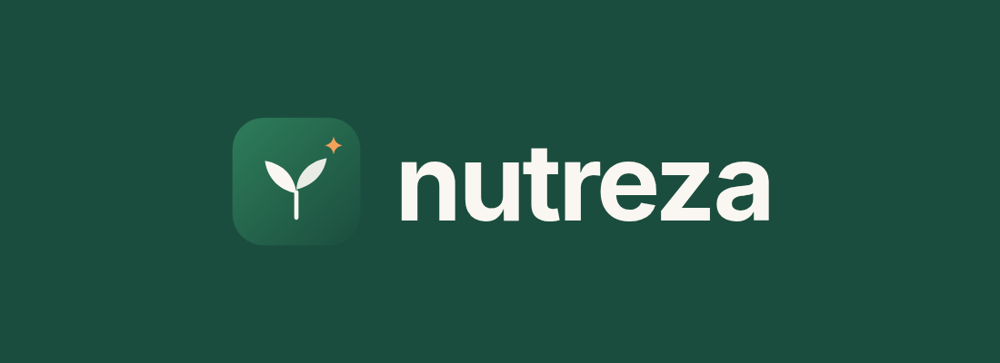
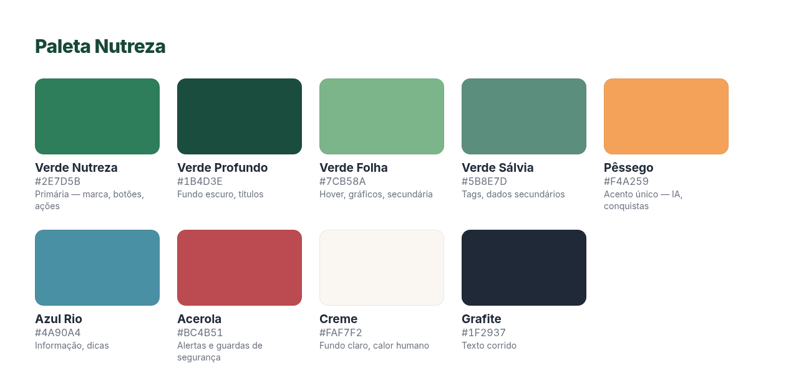
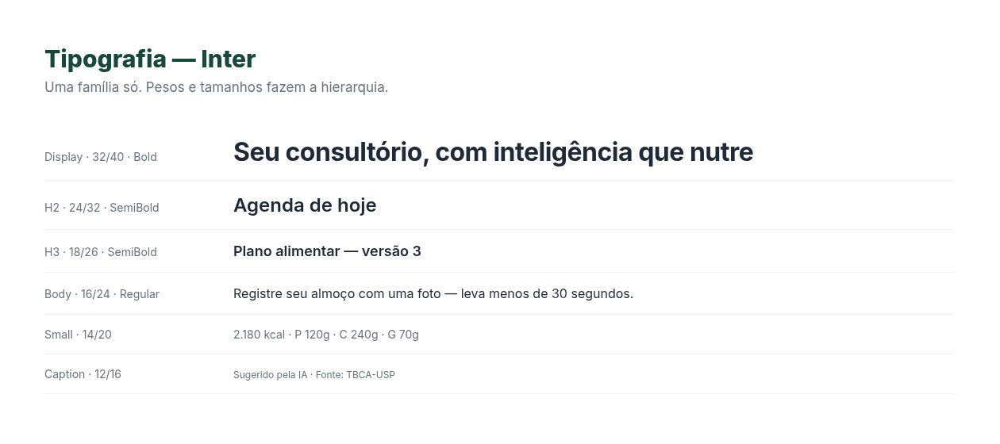

# Nutreza — Brand Identity & Positioning
### Complete brand book · October 2026 · v1.0

> **Brand card**
> **Name:** Nutreza · **AI copilot:** Teca · **Tagline:** *"Tecnologia que nutre o cuidado."*
> **One-liner (PT-BR):** "A Nutreza é a plataforma do nutricionista brasileiro: o copiloto de IA Teca rascunha notas, planos e acompanhamentos — você aprova, e o paciente é acompanhado entre consultas no WhatsApp."
> **Domains:** nutreza.com.br (available at registration time — verify before deposit), nutreza.app, nutreza.ai.



---

## 1. The Name

### 1.1 Brief and criteria

The brief: name a Brazilian SaaS that is the operating system of a nutrition practice, with an embedded AI agent. The name must work spoken in a consultation ("eu monto o plano na ___"), typed into Google, and read by a stressed professional scrolling Instagram. From naming research, the hard criteria were: **2–3 syllables** (recall drops sharply beyond 3 syllables — 2-syllable names show ~68% recall vs ~31% for 4+ syllables) ([TrademarkLens](https://trademarklens.com/guides/business-naming-strategies-2025)); **alternating consonant-vowel pattern** for effortless pronunciation ([TrademarkLens](https://trademarklens.com/guides/business-naming-strategies-2025)); **spellable on first hearing** (if 3 of 10 people spell it wrong, word-of-mouth leaks) ([TrademarkLens](https://trademarklens.com/guides/business-naming-strategies-2025)); **invented or coined** to ease trademark clearance and domain ownership ([Bigeye](https://www.bigeyeagency.com/insights/effective-brand-naming-strategies-for-new-products-companies-how-to-choose-and-create-memorable-brand-names)); and **no collision** with the dense existing "nutri-" namespace (Nutrium, Nutria, NutriDia, Nutrivo, NutriLoop, Nutrilog, Nutren, Nutricia, Nutrata…).

### 1.2 The winner: **Nutreza**

**Nutreza** (pronounced *nu-TRE-za*, 3 syllables, perfect CVCVCV alternation) is a coined word that Brazilians instantly parse as **nutrir + natureza / leveza / pureza / beleza**. The suffix *-eza* is how Portuguese forms abstract nouns of quality (*leveza* = lightness, *pureza* = purity) — so the name literally reads as **"the quality of nourishing"**. It sounds native, warm, and professional at once; it passes the radio test (one spelling, no hyphens, no accents); and it scales beyond Brazil in Spanish and English without embarrassment.

The name also carries the product's strategy inside it: the category is rushing to slap "AI" on everything, and Nutreza deliberately says **nourishment**, not "artificial intelligence" — because the buyer (the nutritionist) buys care and time, not technology. The AI gets its own name (Teca, §6), which keeps the master brand human and the technology a character in service of it.

### 1.3 Screening results (why the finalists lost)

| Candidate | Verdict | Reason |
|---|---|---|
| Nutrora | ❌ | nutreza.com.br competitor check: **nutrora.com.br already registered** (RDAP registro.br) |
| Nutrevia | ❌ | .com.br registered; parked .com |
| Nutreva | ❌ | Live app "Nutreva – Nutrition Companion" on Google Play ([Google Play](https://play.google.com/store/apps/details?id=com.nuetreva.app&hl=pt)) |
| Nutria / Nutriá | ❌ | Live products: nutriaplans.com and somosnutria.com.br ([Nutria](https://somosnutria.com.br/)) |
| NutriDia | ❌ | nutridia.ai live + NGO "Nutridia Brasil" ([Instagram](https://www.instagram.com/nutridiabrasil/)) |
| Nutrivo / NutriLoop | ❌ | Live products (getnutrivo.com; nutriloop.co) ([Nutrivo](https://www.getnutrivo.com/), [NutriLoop](https://nutriloop.co/)) |
| Nutrela | ❌ | Domain free, but Nutrela is a major food brand (India) — international collision risk |
| Nutrelia | ❌ | "Nutrelia" nutrition-coach template kit exists; too close to Nutrella (bread brand) |
| Alimentta | ❌ | Fails the spelling test (double-t); .com taken |
| Nura / Nuri / Pratto / Sabora / Zelar | ❌ | All .com.br registered |

**⚠️ Watch-out:** Nutreza is phonetically close to **Nutresa** (Colombian food group; a Brazilian supplement shop "Nutresa Nutrition" exists) ([Mercado Livre](https://www.mercadolivre.com.br/suplemento-nutricional-nutresa-nutrefit-comprimidos-1000mg-sem-sabor-60un/p/MLB62704794)). Intervocalic s/z are homophones in PT-BR. The categories differ (software vs. food/supplements), but a **professional trademark clearance search (busca de anterioridade) at INPI is mandatory before any deposit** — see §9. This is standard practice, not a blocker: invented 3-syllable words in distinct Nice classes are routinely granted.

---

## 2. Positioning

Built with April Dunford's method: define the competitive alternative, the unique attributes, the value they create, and the segment that cares most ([Wudpecker](https://www.wudpecker.io/blog/obviously-awesome-the-guide-to-perfecting-your-product-positioning)).

### 2.1 Positioning canvas

| Element | Nutreza |
|---|---|
| **Competitive alternative** | The combo every Brazilian nutritionist actually runs today: Excel/Google Sheets + WhatsApp pessoal + PDF + agenda de papel — or legacy software (Dietbox, WebDiet, Nutrium) that digitized the paperwork but not the *work* |
| **Market category** | Practice-management platform for nutritionists — repositioned as **"o consultório com copiloto de IA"** (the AI-copilot practice). We don't fight "software de nutrição" on feature checklists; we shift the category to *who does the work* |
| **Unique attributes** | (1) Teca, a supervised AI copilot that drafts notes, plans and follow-ups — the professional always approves; (2) patient adherence agent living in WhatsApp, Brazil's universal channel; (3) native Brazilian rails: TBCA/TACO, Pix, CFN/LGPD by design; (4) safety guardrails (allergies, contraindications) enforced in code |
| **Value (so that…)** | Hours back per week per professional; fewer no-shows; patients who actually follow the plan between consultations; a practice that grows without more admin |
| **Target segment** | Brazilian nutritionists in private practice, solo or small clinics, early-to-mid career, mobile-first, WhatsApp-native — students enter free and grow into paid |
| **Proof points** | "A IA rascunha, você aprova" workflow; guardrail demo (allergen caught live); meal logged by photo in <30s; Pix recurring billing |

### 2.2 Positioning statement

> **Para** nutricionistas brasileiros de consultório particular **que** perdem horas com plano alimentar, cobrança e follow-up manual, **a Nutreza é** a plataforma de gestão do consultório com um copiloto de IA **que** rascunha o trabalho repetitivo — notas de consulta, planos sobre bases verificadas, mensagens de acompanhamento — enquanto o profissional aprova tudo e o paciente é acompanhado no WhatsApp. **Diferente de** softwares de nutrição tradicionais, **a Nutreza** não apenas digitaliza formulários: ela faz o trabalho invisível, com o nutricionista sempre no controle.

### 2.3 Tagline system

- **Master tagline:** **"Tecnologia que nutre o cuidado."** (technology that nourishes care — mirrors the name)
- Campaign/audience variants:
  - To the nutritionist: **"A IA rascunha. Você aprova. O paciente segue."**
  - Time angle: **"Menos planilha. Mais paciente."**
  - Growth angle: **"Seu consultório cresce. O trabalho não."**
  - Student funnel: **"Comece na faculdade. Cresça com a Nutreza."**
- Never lead with "IA" alone, never promise clinical outcomes ("emagreça X kg"), never say "substitui o nutricionista" — the whole brand is the opposite of that claim.

---

## 3. Brand Platform

- **Purpose (why we exist):** *Nutrir quem nutre.* — nourish those who nourish. Nutritionists spend their days caring for others' health while their own practice runs on duct tape; Nutreza exists to care for the caregiver's business.
- **Mission:** give every Brazilian nutritionist a practice where the invisible work — documentation, calculation, follow-up, billing — is done by a trustworthy copilot, so the consultation hour belongs to the patient.
- **Vision:** become the operating system of nutrition care in Brazil, and the reference for *safe* AI in clinical nutrition.
- **Values (behavioral, not decorative):**
  1. **O profissional decide.** — the human approves, always. No feature ships that bypasses professional judgment.
  2. **Ciência na fonte.** — TBCA, TACO, USDA, guidelines; show the source or don't say it.
  3. **Dados sagrados.** — patient health data is the most sensitive thing we touch; LGPD is a design input, not a legal afterthought.
  4. **Simplicidade obsessiva.** — a tired patient at 10 PM must log dinner in 30 seconds; a nutritionist between consults must find anything in 3 clicks.
  5. **Brasil de verdade.** — WhatsApp, Pix, medidas caseiras, feijão com arroz: we build for the reality, not the imported template.
- **Archetype:** **Caregiver × Sage** (70/30). Warmth and protection with scientific rigor; never Jester (health is serious) and never Ruler (we serve the professional, we don't boss them).
- **Personality sliders:** Warm 70 / Corporate 30 · Playful 30 / Serious 70 · Simple 80 / Sophisticated 20 · Modern 70 / Classic 30 · Bold 40 / Cautious 60.

---

## 4. Voice & Tone

One voice, many tones — the same character adapting to the moment, as the strongest tone-of-voice programs do ([Iconic Fox](https://iconicfox.com.au/brand-tone-of-voice-examples/), [Lokalise](https://lokalise.com/blog/how-to-adapt-your-tone-of-voice-for-new-markets/)).

**Voice (constant):** clara, calorosa, direta — a colleague who happens to be an engineer. Plain language for patients (Headspace's rule: serve the reader's emotional state, not the brand's ego) ([Elite Asia](https://www.eliteasia.co/brand-tone-of-voice-examples/)); technical vocabulary only with professionals. Short sentences. Concrete numbers. No exclamation marks in clinical contexts.

| Context | Tone | Example |
|---|---|---|
| Marketing → nutritionist | Confident, peer-to-peer | "A Teca monta o rascunho do plano em 40 segundos. Você ajusta em 3 minutos e aprova." |
| Product UI → nutritionist | Efficient, respectful | "2 planos aguardando sua aprovação." |
| Teca → nutritionist | Capable, humble, precise | "Rascunhei o plano com 2.180 kcal pela TBCA. Sinalizei 2 pontos para sua revisão." |
| Teca → patient (WhatsApp) | Warm, encouraging, never judgmental | "Vi seu almoço de ontem — ótima escolha! 💪" |
| Errors & payments | Calm, owning the problem | "O Pix não foi confirmado. Nenhum valor foi cobrado — tentar novamente?" |
| Clinical guardrails | Firm, factual | "Este item contém amendoim. A paciente tem alergia registrada. Substitua para continuar." |

**Vocabulary:** say "acompanhamento" not "monitoramento"; "paciente" in clinical UI, "pessoa/usuário" in marketing; "plano alimentar" not "dieta" (diet has punitive connotation in PT-BR); "a IA rascunha/sugere" never "a IA decide/prescreve"; Teca is "ela" (feminine persona).

### 4.1 Teca — the copilot persona

**Teca** (from **TA**CO + TB**CA**, the Brazilian food-composition tables every nutritionist trusts) is the name and face of the AI. Female-presenting, warm-professional, avocado-toast-generation energy without slang abuse. Rules: she always identifies herself as AI ("Sou a Teca, assistente do consultório da Dra. Ana"); she never improvises clinical content — only what the professional approved; she escalates gracefully ("Essa pergunta é importante — encaminhei para sua nutri, que responde até amanhã"); she celebrates adherence without calorie-shaming.



---

## 5. Visual Identity

### 5.1 Logo

The symbol is **"o broto" (the sprout)**: two leaves growing from a single stem inside a rounded square — growth, nourishment, and new beginnings, reading instantly at favicon size. The small **peach spark** at the upper right is Teca's mark: the AI is present, but it's a spark beside the plant, never the plant itself. The wordmark is lowercase **Inter Bold** with tight tracking — lowercase because the brand is approachable; bold because it's dependable.





**Rules:** clear space = height of the sprout's stem around all sides; minimum size 24 px (icon) / 90 px wide (lockup); never rotate, recolor outside tokens, place on busy photos without scrim, or separate the spark from the sprout in the primary icon. Monochrome versions (all-white / all-Verde-Profundo) for stamps, receipts, and watermark use.

### 5.2 Color

Health and wellness brands earn trust through green/blue cool palettes — empirically associated with calm, healing and balance in healthcare environments ([Lovable](https://lovable.dev/guides/how-to-design-a-healthcare-logo)); 2026 wellness branding is consolidating around deep greens paired with warm neutrals ([Jen Drews / LinkedIn](https://www.linkedin.com/posts/jen-drews-a715a9176_design-trends-for-wellness-brands-in-2026-activity-7417574814191710208-ByQP)). Nutreza's system: **deep greens do the trust work, Creme adds human warmth, and Pêssego is the single warm accent** — reserved for Teca/AI moments and achievements, so it never competes with clinical information. Acerola is strictly for safety alerts.



### 5.3 Typography

One family — **Inter** — across product, marketing, and documents (open-source, excellent tabular numerals for kcal/macros, full PT-BR diacritics). Hierarchy by weight and size, not by mixing families.



### 5.4 Imagery & iconography

Photography: real Brazilian food and real consultation moments — natural light, warm tones, no sterile stock, no body-shaming imagery (never "before/after" bodies in brand materials; progress is shown as energy, routine, markers). Iconography: outline style (Lucide), rounded joins, 2 px stroke. Illustration (sparingly, marketing only): flat botanical shapes in palette colors. Charts always use the palette in fixed order.

---

## 6. Brand Architecture

```
Nutreza (master brand — the platform)
├── Teca (the AI copilot — named character, works in-app and on WhatsApp)
├── Nutreza Web (the nutritionist's app)
├── Nutreza Paciente (the patient PWA)
└── Plans: Estudante · Essencial · Profissional · Clínica (descriptive, unbranded)
```

Descriptive sub-names keep the master brand clean and the portfolio future-proof (clinics, LATAM, new features). Feature names stay descriptive in PT-BR ("Plano alimentar", "Diário", "Relatórios") — only Teca gets a proper name, because she's a character, not a feature. AI-copilot naming research confirms: names should signal *assisted* intelligence — guidance, not autonomy — which is exactly the "rascunha/aprova" relationship ([Namestation](https://www.namestation.com/names/ai-copilot)).

---

## 7. Applications Quick Reference

- **App icon / favicon:** sprout icon on gradient; 48 px legibility verified.
- **Landing hero:** lockup on Creme, headline in Verde Profundo, one Pêssego CTA.
- **WhatsApp/Teca:** Teca avatar (Pêssego circle + spark) as profile photo; message tone per §4.
- **Patient PDFs (plans, receipts):** header with the *nutritionist's* brand (their logo/color), small "Feito com Nutreza" footer badge — their brand first, ours second. This is a deliberate growth loop: every PDF markets Nutreza to the next patient-who-is-also-a-future-colleague.
- **Social:** avatar = icon; covers use palette gradients; content pillars: bastidores do consultório, ciência de verdade (mitos), Teca demos, conquistas de nutris.
- **E-mail:** plain-text feel, lockup in footer, one idea per e-mail.

---

## 8. Messaging Bank

- **Elevator (10s):** "A Nutreza é o sistema do consultório de nutrição com uma copiloto de IA, a Teca: ela rascunha planos e acompanha o paciente no WhatsApp — e o nutricionista aprova tudo."
- **Elevator (30s):** "Nutricionista perde horas montando plano, cobrando e correndo atrás de paciente que some. A Nutreza junta agenda, prontuário, plano alimentar e financeiro num lugar só — e a Teca, nossa IA, faz o rascunho de tudo com base científica e travas de segurança. O profissional revisa e aprova; o paciente recebe o plano no celular e é acompanhado pela Teca no WhatsApp entre consultas. Mais adesão, menos no-show, consultório que cresce sem mais trabalho manual."
- **Boilerplate (press/about):** "A Nutreza é uma plataforma brasileira para nutricionistas que reúne gestão do consultório — agenda, prontuário, plano alimentar, financeiro e teleconsulta — com Teca, um copiloto de IA supervisionado que rascunha documentos e planos sobre bases científicas verificadas e acompanha pacientes pelo WhatsApp, sempre com aprovação do profissional. Feita para a realidade brasileira: TBCA/TACO, Pix, LGPD e CFN por desenho."
- **Headline bank:** "Seu consultório, com inteligência que nutre." · "O plano se escreve enquanto você atende." · "Seu paciente não some mais entre consultas." · "A IA que trabalha para o nutricionista — nunca no lugar dele." · "Do primeiro atendimento à centésima paciente, sem mudar de ferramenta."
- **Objection copy:** "IA na nutrição é perigoso?" → "Por isso a Teca nunca prescreve: ela rascunha, mostra a fonte, passa por travas de segurança — e quem aprova é você. A responsabilidade técnica continua onde a lei manda: com o nutricionista."

---

## 9. Legal & Operational (Brazil)

- **INPI trademark:** register "NUTREZA" (nominativa) and the logo (mista) in Nice classes **9** (software), **42** (SaaS) and **44** (health services). Cost: **R$ 440/class with the 50% discount** (MEI/ME/EPP/pessoa física, pré-aprovada spec) or R$ 880–1.720 full; since Sept 2025 it's a single upfront payment covering grant + first 10 years; average timeline 13–18 months without opposition ([Contajá](https://contaja.com.br/blog/quanto-custa-registrar-uma-marca/), [SOS Marcas](https://sosmarcasepatentes.com.br/guia-atualizado-prazos-e-procedimentos-do-inpi-em-2025/), [Inhands](https://inhands.com.br/blog/quanto-custa-registrar-a-sua-marca/)).
- **Before deposit:** professional *busca de anterioridade* at INPI (the Nutresa phonetic proximity in §1.3 must be formally assessed — different Nice classes, but verify); use the mark freely meanwhile, as priority counts from the deposit date ([Contajá](https://contaja.com.br/blog/quanto-custa-registrar-uma-marca/)).
- **Domains to secure on day one:** nutreza.com.br (primary — available per RDAP/registro.br check at writing; re-verify), nutreza.app, nutreza.ai, plus defensive: nutreza.com.br variants (app.nutreza.com.br for product).
- **Social handles:** @nutreza / @nutreza.app on Instagram, TikTok, LinkedIn, YouTube — grab all, even dormant.
- **LGPD hygiene from day zero:** the brand promise "Dados sagrados" must be true in the privacy policy, the DPA with LLM providers, and the in-app consent flows.

---

## 10. Launch Checklist

- [ ] INPI anterioridade search → deposit classes 9/42/44 (marca mista + nominativa)
- [ ] Register domains + social handles; set up Google Workspace on nutreza.com.br
- [ ] Apply tokens from §5 to the UI/UX master prompt (replace palette/typography sections — they're already aligned)
- [ ] Design Teca's avatar states (idle, thinking, alert) and WhatsApp templates in her voice
- [ ] Landing page copy from §8; hero = product screenshot with Teca draft visible
- [ ] "Feito com Nutreza" badge on patient PDFs (student plan: full badge; paid plans: subtle)
- [ ] Brand assets folder (this document's `img/`) shared with everyone who touches design

---

*Document created October 2026 as part of the Nutreza product research series. Naming, domains and trademark observations reflect checks performed on 2026-10-02 and must be re-verified before legal deposit. This document is informational and does not constitute legal advice.*
