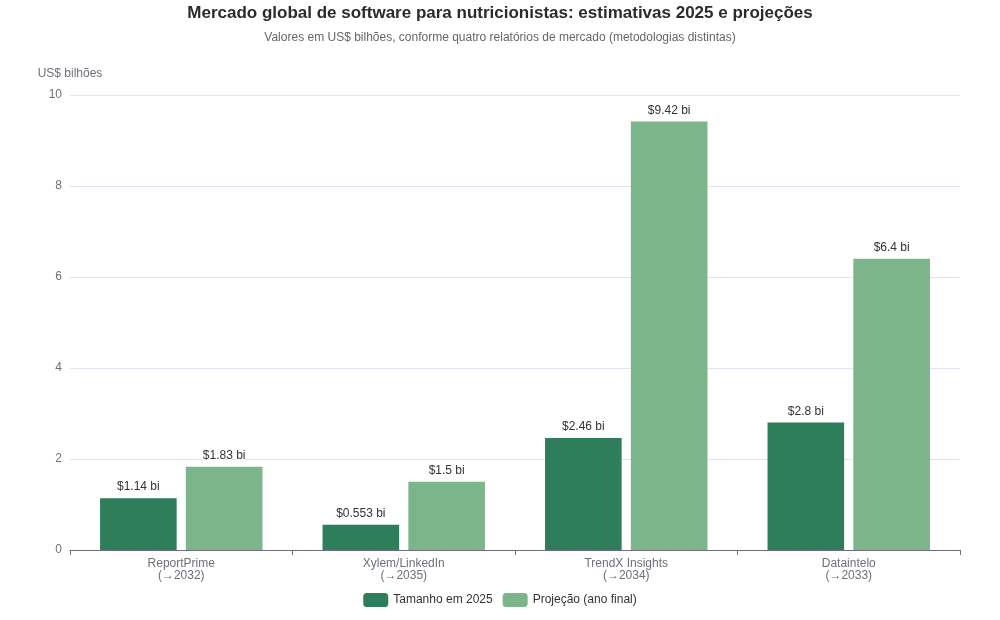
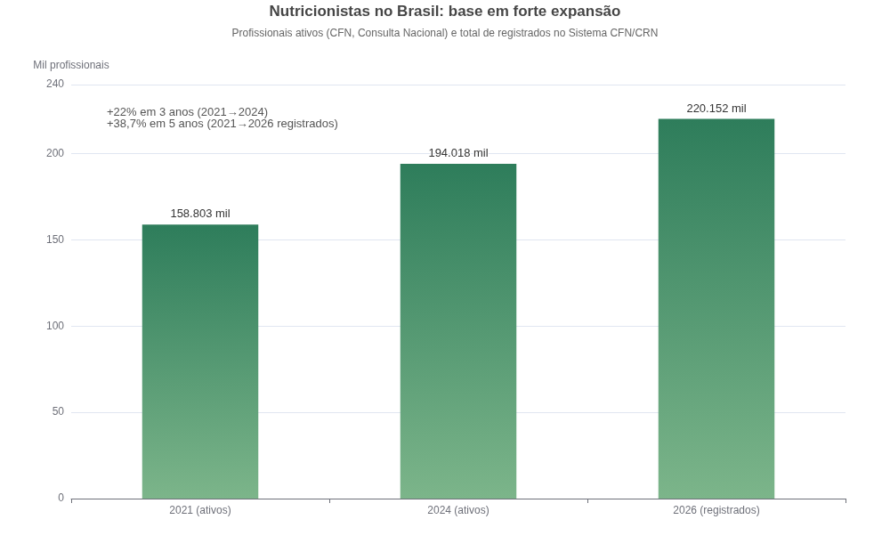
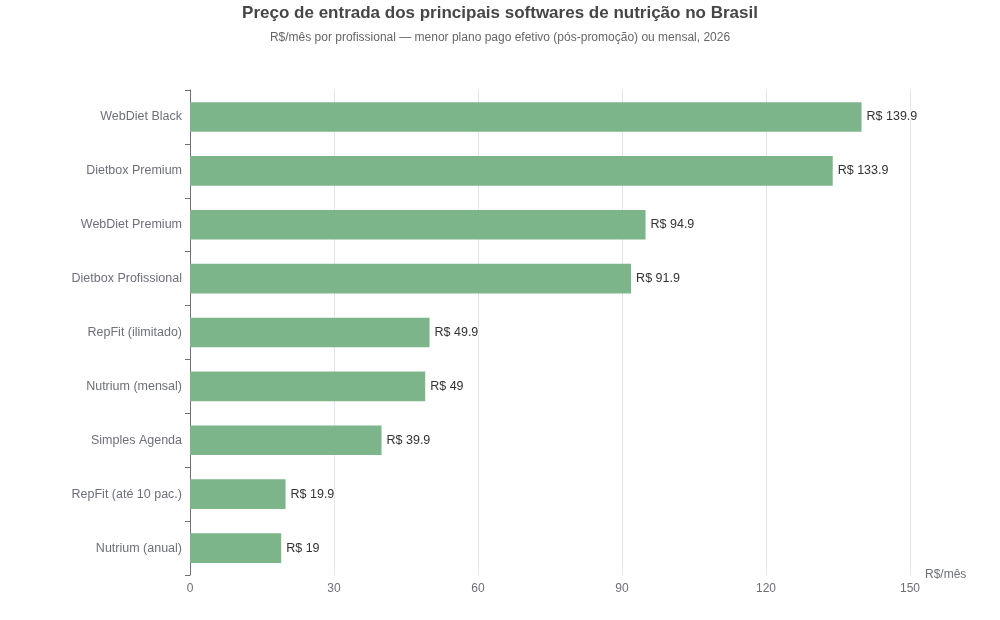
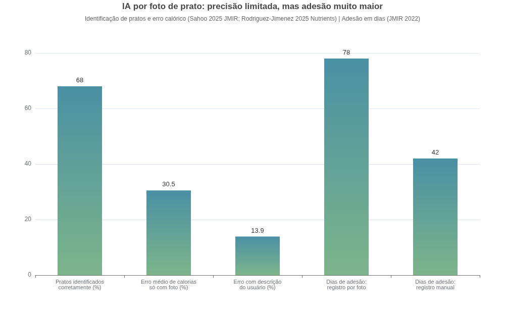
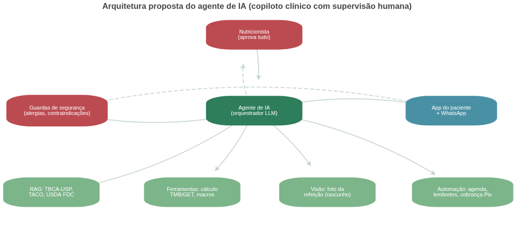
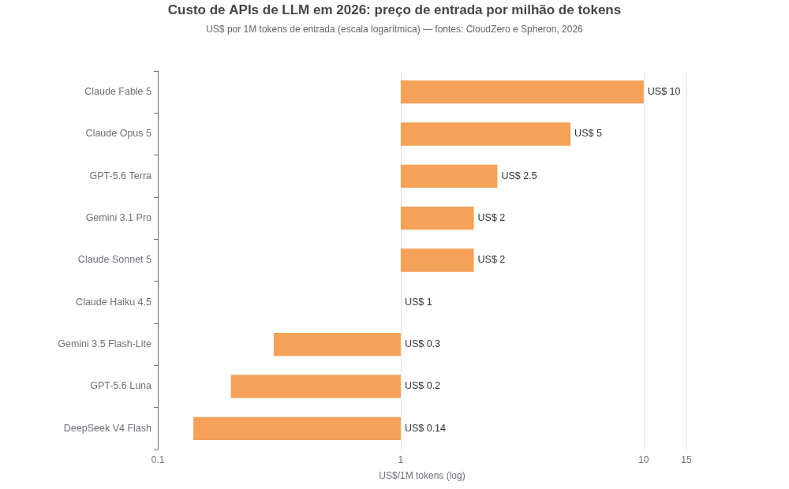
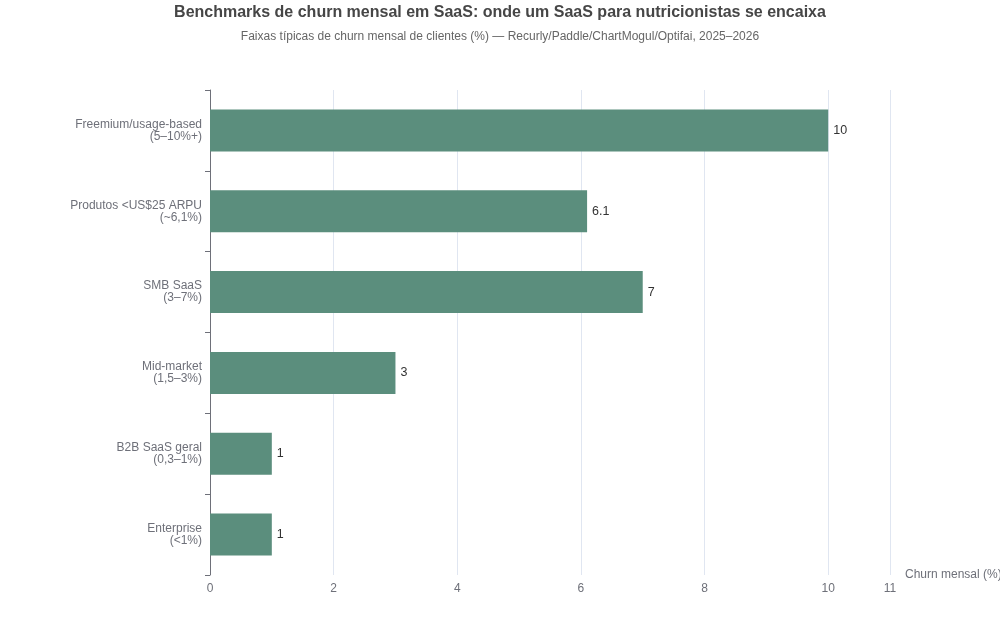

# SaaS para Nutricionistas com Agente de IA: Pesquisa Aprofundada de Mercado, Produto e Tecnologia

**Data da pesquisa:** outubro de 2026 · **Escopo:** Brasil como mercado primário, com benchmarks internacionais · **Formato:** relatório de pesquisa para decisão de produto e investimento

---

## Sumário executivo

A ideia de construir um SaaS para nutricionistas com um agente de IA embarcado é **viável, tem mercado comprovado e chega num momento tecnicamente favorável** — mas o diferencial não está em "colocar IA" no produto, e sim em **onde a IA atua**. O mercado global de software para nutricionistas foi estimado entre **US$ 553 milhões e US$ 2,8 bilhões em 2025** dependendo da metodologia, com projeções de crescimento anual entre 7% e 16,1% até 2032–2034 ([ReportPrime](https://www.reportprime.com/dietitian-software-r14944), [TrendX Insights](https://trendxinsights.com/syndicated-market-research-reports/healthcare-dietitian-nutrition-software-market/)). No Brasil, o Sistema CFN/CRN registra **220.152 nutricionistas inscritos**, uma base que cresceu 22% em três anos no recorte de profissionais ativos ([CFN](https://cfn.org.br/), [Webrun](https://webrun.com.br/pesquisa-confirma-crescimento-de-22-de-nutricionistas-no-brasil/)). A concorrência já é real — Dietbox, WebDiet, Nutrium (que tem o Brasil como principal mercado), Practice Better e Healthie —, porém **nenhum player oferece hoje um agente de IA completo**: o que existe são transcrição de consulta e anotação automática, vendidas como add-ons de US$ 10–35/mês ([Practice Better](https://practicebetter.io/compare/practice-better-vs-healthie), [FindEMR](https://www.findemr.com/resources/healthie-vs-practice-better/)).

A pesquisa documental e científica aponta três conclusões estruturantes. Primeiro, a evidência clínica é clara: **LLMs usados sozinhos geram planos alimentares com falhas de segurança** — alergênicos incluídos em dietas restritivas, desequilíbrio de macronutrientes e erros calóricos que passam de 20% —, o que torna obrigatório o desenho de "copiloto supervisionado", em que a IA rascunha e o nutricionista aprova ([Onay et al., 2025](https://pubmed.ncbi.nlm.nih.gov/41054023/), [MDPI — Nutrients](https://pmc.ncbi.nlm.nih.gov/articles/PMC11768065/)). Segundo, o custo de LLMs despencou a ponto de viabilizar agentes ricos em um produto de R$ 50–150/mês: modelos de produção custam entre **US$ 0,14 e US$ 2,00 por milhão de tokens de entrada** em 2026 ([CloudZero](https://www.cloudzero.com/blog/llm-api-pricing-comparison/), [Spheron](https://www.spheron.network/blog/llm-api-pricing-comparison-gpt-claude-gemini-deepseek-2026/)). Terceiro, o Brasil oferece vantagens logísticas únicas para este produto: **WhatsApp com 93% de penetração populacional** como canal de engajamento do paciente, Pix Automático para cobrança recorrente barata e a Resolução CFN 760/2023 consolidando a telenutrição como modalidade permanente ([Statista](https://www.statista.com/topics/7731/whatsapp-in-brazil/), [Forja de Sistemas](https://forjadesistemas.com.br/blog/pix-automatico-recorrencia-saas-proprio-2026), [Link Singular](https://linksingular.com/nutrition/pt/blog/teleconsulta-nutricionista-regras-cfn)).

Este relatório detalha mercado, concorrência, funcionalidades essenciais, desenho do agente de IA com seus limites de segurança, obrigações regulatórias (LGPD e CFN), monetização com unit economics, stack técnica e roadmap em quatro fases. A tese final: **o produto vencedor não é "o ChatGPT da nutrição", e sim o sistema operacional do consultório de nutrição cuja IA elimina o trabalho invisível** — documentação, cálculo, montagem de plano, follow-up do paciente e cobrança — mantendo o julgamento clínico sempre com o profissional. A janela competitiva estimada é de 12 a 24 meses antes que incumbentes capitalizados repliquem o movimento, o que recomenda velocidade de execução com foco estreito: fechar primeiro o ciclo "agendar → atender → prescrever → paciente executa → cobrar" para um público de consultório particular, e só então expandir para clínicas e outros países da América Latina.

---

## 1. Mercado e oportunidade

### 1.1 Tamanho e dinâmica do mercado global

As estimativas de mercado para software de nutrição/dietética variam bastante entre consultorias, o que é típico de nichos em consolidação. A ReportPrime dimensiona o mercado de "dietitian software" em **US$ 1,14 bilhão em 2025**, projetando US$ 1,83 bilhão até 2032 (CAGR de 7%) ([ReportPrime](https://www.reportprime.com/dietitian-software-r14944)). A TrendX Insights, com um escopo mais amplo de "healthcare dietitian nutrition software", estima **US$ 2,46 bilhões em 2025 crescendo a 16,1% ao ano até US$ 9,42 bilhões em 2034**, com a América do Norte respondendo por 51,2% do mercado ([TrendX Insights](https://trendxinsights.com/syndicated-market-research-reports/healthcare-dietitian-nutrition-software-market/)). Outras duas fontes completam o intervalo: uma análise divulgada no LinkedIn aponta US$ 553 milhões em 2025 rumo a US$ 1,5 bilhão em 2035 ([LinkedIn/Xylem](https://www.linkedin.com/pulse/global-dietitian-software-market-size-growth-opportunities-xyl3f/)), e a Dataintelo fala em US$ 2,8 bilhões em 2025 para US$ 6,4 bilhões em 2033 ([Dataintelo](https://dataintelo.com/report/global-dietitian-software-market)). Mesmo na estimativa mais conservadora, trata-se de um mercado global de nove dígitos crescendo acima do software tradicional, puxado pela digitalização de consultórios, pela epidemia de doenças crônicas ligadas à alimentação e pela integração de IA.

Dois vetores estruturais merecem destaque para além dos números de consultoria. O primeiro é a consolidação por capital: a Nutrium, startup portuguesa fundada em 2015, levantou **€ 10 milhões em setembro de 2025** (total acumulado de € 16,8 milhões) liderados pela Vesalius Biocapital, com a meta explícita de escalar nos EUA e consolidar o Brasil — que a empresa declara ser seu **principal mercado** tanto no software quanto no programa corporativo ([Portugal Startup News](https://portugalstartupnews.com/2025/09/16/nutrium-raises-e10m-to-scale-corporate-nutrition-program-in-u-s/)). A Dealroom estima sua receita anual na faixa de US$ 50–100 milhões ([Dealroom](https://dealroom.co/companies/nutrium/)). O segundo vetor é a explosão dos agonistas de GLP-1 (semaglutida, tirzepatida): o mercado global desses fármacos foi estimado em **US$ 60,6 bilhões em 2025** com projeção de US$ 307 bilhões em 2035, e cerca de 23% dos lares americanos já têm ao menos um usuário ([The Food Tech](https://thefoodtech.com/soluciones-y-tecnologia-alimentaria/ozempic-cambia-el-menu-que-categorias-de-alimentos-ganaran-terreno-hacia-2030/)). Cada paciente em GLP-1 precisa de acompanhamento nutricional para mitigar sintomas gastrointestinais e perda de massa magra — demanda que o próprio ecossistema de nutrição já reconhece como prioridade clínica ([Dietbox](https://blog.dietbox.me/novos-medicamentos-glp-1-o-que-nutricionistas-precisam-saber/)). Para um SaaS de nutricionistas, isso se traduz em módulos específicos (protocolos GLP-1, monitoramento de composição corporal, alertas de perda de massa magra) que ainda são território vazio na concorrência.

### 1.2 O mercado brasileiro: base de clientes, renda e disposição a pagar

O Brasil é um dos maiores mercados do mundo para este produto por uma razão simples: volume de profissionais. O Sistema CFN/CRN contabiliza **220.152 nutricionistas registrados** (além de 21.095 técnicos em nutrição), e a pesquisa Consulta Nacional de Nutricionistas apontou **194.018 profissionais em atividade em 2024, contra 158.803 em 2021 — crescimento de 22% em três anos** ([CFN](https://cfn.org.br/), [Webrun](https://webrun.com.br/pesquisa-confirma-crescimento-de-22-de-nutricionistas-no-brasil/)). A concentração geográfica facilita go-to-market focado: São Paulo reúne 34.189 registros, seguido por Rio de Janeiro (15.254) e Minas Gerais (12.786), e a Região Sudeste soma 64.664 profissionais ([Webrun](https://webrun.com.br/pesquisa-confirma-crescimento-de-22-de-nutricionistas-no-brasil/)). É uma base majoritariamente qualificada (73,2% têm pós-graduação), mas com renda apertada: 73,2% dos que atuam em clínicas ganham entre um e cinco salários mínimos, e a remuneração média nacional apurada pelo DIEESE era de R$ 4.156 em dezembro de 2022 ([Webrun](https://webrun.com.br/pesquisa-confirma-crescimento-de-22-de-nutricionistas-no-brasil/), [FNN/DIEESE](https://www.fnn.org.br/arquivos/noticias/relatorio-nutricionistas-2025.pdf)).

Esse perfil de renda define o teto de preço do produto e explica o padrão de precificação observado na concorrência brasileira, que se concentra entre R$ 20 e R$ 140/mês — discutido em detalhe na seção 2. A âncora de valor, porém, é generosa: uma consulta particular inicial custa em média **R$ 150–500**, com retornos de R$ 100–300, e a tabela de honorários de referência da categoria sugere R$ 192,54 para consulta clínica ([Meutudo](https://meutudo.com.br/blog/quanto-custa-uma-consulta-com-nutricionista/), [Nutritotal](https://nutritotal.com.br/pro/material/tabela-de-honorarios-de-nutricionistas-2021/)). Um software que custa R$ 89/mês e economiza algumas horas semanais ou evita uma única falta por mês já se paga: o agendamento com cobrança via Pix, por exemplo, é apontado como capaz de **reduzir faltas em até 50%** ([Simples Agenda](https://www.simplesagenda.com.br/site/software-para-nutricionista)). A venda, portanto, deve ser ancorada em retorno financeiro do consultório (mais consultas, menos no-show, retenção de pacientes) e não em "tecnologia" abstrata.

Há ainda um segmento de entrada frequentemente ignorado pelos análises de mercado: estudantes e recém-formados. A Dietbox revelou que **60% dos seus cadastros eram de estudantes de nutrição**, que assinavam para ter acesso a ferramentas como antropometria mesmo sem poder clinicar ([Projeto Draft](https://www.projetodraft.com/o-dietbox-quer-digitalizar-a-relacao-nutricionista-paciente/)). Isso sugere um funil de aquisição barato via plano educacional gratuito ou simbólico — a mesma tática do plano Sprout gratuito da Practice Better para recém-formados nos EUA — capturando o profissional antes que ele forme hábito em outro sistema, com conversão natural quando começa a atender ([Jotform](https://www.jotform.com/blog/healthie-vs-practice-better/)). O efeito cumulativo desse funil é poderoso: cada turma de formandos em nutrição entra no mercado já "falando a língua" da plataforma em que estudou, e a migração posterior de sistema é cara em tempo e dados, o que torna a captura precoce uma vantagem competitiva defensável.

### 1.3 Ventos favoráveis: WhatsApp, telenutrição regulamentada e pagamentos instantâneos

Três características do Brasil reduzem dramaticamente o custo de construção e adoção deste produto em comparação com mercados como os EUA. A primeira é o WhatsApp como infraestrutura nacional de comunicação: **93% da população brasileira usa o aplicativo**, 97% dos usuários o abrem ao menos uma vez ao dia e 66% já contrataram serviços pela plataforma ([Statista](https://www.statista.com/topics/7731/whatsapp-in-brazil/), [Ageubot](https://ageubot.com.br/blog/estatisticas-whatsapp-brasil-2026/)). Para um produto cuja métrica central é a adesão do paciente entre consultas, poder entregar o agente de IA **dentro do WhatsApp** — em vez de exigir o download de mais um app — é uma vantagem de distribuição que nenhum concorrente americano tem. Os custos da API oficial são baixos: conversas de serviço custam cerca de R$ 0,03 e as primeiras 1.000 conversas mensais são gratuitas ([SocialHub](https://www.socialhub.pro/blog/whatsapp-cloud-api-2026/)).

A segunda vantagem é regulatória no bom sentido: a **Resolução CFN nº 760/2023** consolidou a telenutrição como modalidade permanente de atendimento, com quatro exigências objetivas — registro ativo no CRN, cadastro prévio na plataforma e-Nutricionista, aceite do TCLE pelo paciente e registro do atendimento em prontuário ([Link Singular](https://linksingular.com/nutrition/pt/blog/teleconsulta-nutricionista-regras-cfn)). Um SaaS que automatiza exatamente esses quatro pontos (verificação de cadastro, TCLE digital com aceite registrado, prontuário vinculado à teleconsulta) transforma obrigação regulatória em argumento de venda. A terceira vantagem é financeira: o **Pix Automático**, modalidade de débito recorrente lançada pelo Banco Central (Resolução BC nº 422/2025), permite cobrar assinaturas e pacotes com taxas de **0,22% a 0,35%, contra 3,49% + R$ 0,39 do Stripe** em recorrência no cartão ([Forja de Sistemas](https://forjadesistemas.com.br/blog/pix-automatico-recorrencia-saas-proprio-2026)). Com 76% da população usando Pix, o checkout do produto e a cobrança dos pacientes dos nutricionistas (pacotes, mensalidades de acompanhamento) ficam mais baratos e com menor churn involuntário por falha de cartão ([Nexforce](https://nexforce.ai/blog/pix-automatico-recorrencia-saas)).

---

## 2. Concorrência

### 2.1 Players brasileiros

O mercado brasileiro já tem um líder estabelecido e uma cauda longa de alternativas. A **Dietbox**, fundada em 2013 em Porto Alegre, declara ser o software de nutrição mais usado no Brasil, com **mais de 170 mil profissionais e estudantes cadastrados e 2,5 milhões de pacientes** na plataforma, faturamento que passava de R$ 5 milhões em 2019 e crescimento médio de 60% ao ano antes da pandemia ([Segs](https://www.segs.com.br/saude/215032-startup-gaucha-fatura-mais-de-r-5-milhoes-com-plataforma-para-nutricionistas), [Projeto Draft](https://www.projetodraft.com/o-dietbox-quer-digitalizar-a-relacao-nutricionista-paciente/)). Seu modelo é self-service com conversão de 15% do trial — número alto para SaaS vertical — e sua precificação atual parte de R$ 91,90/mês no plano Profissional após o período promocional, chegando a R$ 133,90 no Premium ([Semente Negócios](https://sementenegocios.com.br/blog/dietbox-e-o-modelo-de-venda-self-service/), [RepFit](https://www.repfit.io/blog/melhor-app-para-nutricionista/)). A **WebDiet** ocupa posição similar, com plano Premium a R$ 94,90/mês pós-promoção e Black a R$ 139,90, e investe em conteúdo sobre gestão de consultório (agenda, financeiro, recibos) como eixo de marketing ([RepFit](https://www.repfit.io/blog/melhor-app-para-nutricionista/), [WebDiet](https://blog.webdiet.com.br/2026/09/14/software-para-nutricionistas-webdiet-gestao-financeira-e-agenda/)).

A cauda do mercado mostra pressão de preço por baixo e por modelos alternativos. O **RepFit** ataca o nicho de nutrição esportiva com R$ 19,90/mês (até 10 pacientes) ou R$ 49,90 ilimitado ([RepFit](https://www.repfit.io/blog/melhor-app-para-nutricionista/)). O **Simples Agenda** vende gestão de consultório com agendamento online e Pix a partir de R$ 39,90/mês ([Simples Agenda](https://www.simplesagenda.com.br/site/software-para-nutricionista)). Há ainda o modelo de licença vitalícia (ClínicaSys Pro, R$ 997 pagamento único), prontuários generalistas com módulo de nutrição e IA de documentação (Amplimed, com a "Ampli IA") e novos entrantes como Klinity e Omnicare, que já prometem transcrição de consulta com IA e economia de até 70% do tempo de documentação ([ClínicaSys](https://www.clinicasyspro.com.br/sistema-para-nutricionista.html), [Amplimed](https://www.amplimed.com.br/blog/software-para-nutricionistas/), [Klinity](https://www.klinity.com/blog/software-gestao-nutricionista-eficiencia-consultorio)). A **Nutrium** opera no Brasil com preço agressivo de R$ 19/mês no plano anual (R$ 49 mensal), app gratuito para o paciente e mais de 15 bases de dados de alimentos — e, como visto, considera o Brasil seu principal mercado ([Nutrium](https://nutrium.com/pt-br/professionals), [Appvizer](https://www.appvizer.com.br/saude/nutricao/nutrium)).

### 2.2 Players internacionais e o que eles ensinam

Nos EUA e Canadá, a disputa entre **Practice Better** e **Healthie** oferece o melhor mapa do que o mercado valoriza quando maduro. A Practice Better tem plano gratuito para recém-formados (3 clientes), Starter a US$ 35/mês (10 clientes, ou US$ 25 no anual), Professional a US$ 69 (300 clientes), Plus a US$ 99 (clientes ilimitados) e Team a US$ 155 ([Practice Better](https://practicebetter.io/compare/practice-better-vs-healthie)). A Healthie parte de US$ 19/mês (Core, 10 clientes) até US$ 129 no Plus, com diferencial de faturamento de convênios (CMS-1500) — algo irrelevante no Brasil, onde o modelo é predominantemente particular ([FindEMR](https://www.findemr.com/resources/healthie-vs-practice-better/)). Ambas cobram extra pela IA: o AI Charting Assistant da Practice Better custa a partir de **US$ 10/mês** e o AI Scribe da Healthie, a partir de **US$ 35/mês** ([Practice Better](https://practicebetter.io/compare/practice-better-vs-healthie)).

Três lições emergem desse comparativo. Primeiro, o preço por faixa de clientes ativos (3/10/300/ilimitado) é o padrão do mercado e casa bem com a realidade de renda do nutricionista brasileiro — um modelo híbrido de "faixas de pacientes + planos de funcionalidade" é o esperado pelo cliente. Segundo, **IA está sendo monetizada separadamente como add-on**, o que abre espaço tanto para uma estratégia de "IA inclusa como diferencial" quanto para "IA como camada premium"; a escolha tem impacto direto em CAC e margem, discutido na seção 7. Terceiro, há uma lacuna funcional clara mesmo nos líderes: uma análise independente de 2026 aponta que **nem Healthie nem Practice Better têm geração automática de planos alimentares por metas de macros** — o gap é preenchido por ferramentas complementares como a Promealplan, que gera planos em 15–35 segundos com precisão de 2% nos macros e cobra US$ 49/mês ([Promealplan](https://www.promealplan.com/en/blog/healthie-vs-practice-better)). Ou seja: automação inteligente de plano alimentar é demanda real, validada por um player que vive só disso, e ausente das plataformas de gestão.

### 2.3 Mapa competitivo consolidado e lacuna de posicionamento

A tabela abaixo consolida os principais concorrentes diretos e adjacentes, com preço de entrada, escala declarada e o estado atual de suas funcionalidades de IA. O padrão é nítido: a IA existente nos concorrentes é **reativa e documental** (transcrever, resumir, preencher prontuário), e nenhum player oferece um **agente proativo** que acompanhe o paciente entre consultas, detecte risco de abandono e prepare o terreno para a consulta seguinte. É exatamente aí que a oportunidade de posicionamento mora — desde que, como a seção 4 detalha, o desenho respeite os limites de segurança que a literatura científica impõe. A lacuna é ainda mais visível no Brasil, onde os líderes locais (Dietbox e WebDiet) mal começaram a expor recursos de IA, e onde a integração WhatsApp + Pix + bases brasileiras de alimentos cria barreiras de localização que dificultam a resposta rápida dos players internacionais.

| Produto | Origem | Preço de entrada | Escala declarada | IA hoje |
|---|---|---|---|---|
| Dietbox | Brasil | R$ 91,90/mês (Profissional, pós-promoção) ([RepFit](https://www.repfit.io/blog/melhor-app-para-nutricionista/)) | 170 mil profissionais e estudantes; 2,5 mi pacientes ([Projeto Draft](https://www.projetodraft.com/o-dietbox-quer-digitalizar-a-relacao-nutricionista-paciente/)) | Incipiente; foco em app do paciente e gestão |
| WebDiet | Brasil | R$ 94,90/mês (Premium, pós-promoção) ([RepFit](https://www.repfit.io/blog/melhor-app-para-nutricionista/)) | Não declarada | Incipiente |
| Nutrium | Portugal | R$ 19/mês anual ou R$ 49 mensal no Brasil ([Nutrium](https://nutrium.com/pt-br/professionals)) | 350 mil nutricionistas, 3 mi+ pacientes, 90+ países; Brasil é o principal mercado ([Portugal Startup News](https://portugalstartupnews.com/2025/09/16/nutrium-raises-e10m-to-scale-corporate-nutrition-program-in-u-s/)) | Notas de consulta geradas por IA; visão declarada de "nutricionista e IA lado a lado" |
| Practice Better | Canadá/EUA | Grátis (3 clientes) ou US$ 35/mês ([Jotform](https://www.jotform.com/blog/healthie-vs-practice-better/)) | Líder entre solo practitioners nos EUA | AI Charting Assistant, add-on a partir de US$ 10/mês |
| Healthie | EUA | US$ 19/mês (10 clientes) ([FindEMR](https://www.findemr.com/resources/healthie-vs-practice-better/)) | Foco enterprise e faturamento de convênios | AI Scribe, add-on a partir de US$ 35/mês |
| Promealplan | França | Grátis (3 planos) ou US$ 49/mês ([Promealplan](https://www.promealplan.com/en/blog/healthie-vs-practice-better)) | Ferramenta complementar de nicho | Geração determinística de planos por macros (não-LLM) |
| RepFit | Brasil | R$ 19,90/mês (até 10 pacientes) ([RepFit](https://www.repfit.io/blog/melhor-app-para-nutricionista/)) | Nicho esportivo | Não declarada |
| Amplimed / Klinity / Omnicare | Brasil | Variável | Prontuários generalistas/novos entrantes | Transcrição e preenchimento de prontuário com IA ([Klinity](https://www.klinity.com/blog/software-gestao-nutricionista-eficiencia-consultorio)) |

Lendo o mapa de cima para baixo, a conclusão estratégica é dupla. Por um lado, **competir em "gestão de consultório" puro é briga de preço** em um mercado com players a R$ 19–40/mês e vitalícios a R$ 997 — entrada commoditizada. Por outro lado, nenhum concorrente entrega hoje o pacote completo de "copiloto clínico + agente de engajamento do paciente via WhatsApp + automação financeira", e a Nutrium — o player mais bem capitalizado e com foco no Brasil — apenas começou a falar em IA. Há uma janela de 12–24 meses, típica do ciclo de desenvolvimento de incumbentes, para ocupar essa posição antes que ela vire feature padrão do mercado.

---

## 3. Produto: as funcionalidades necessárias para o nutricionista

### 3.1 Núcleo clínico: onde o valor profissional é criado

O coração do produto é o fluxo clínico, e ele precisa ser impecável antes de qualquer IA. A sequência canônica do atendimento nutricional brasileiro envolve: **anamnese** (histórico clínico, alimentar, medicamentos, alergias e intolerâncias), **avaliação antropométrica** (peso, altura, IMC, circunferências, dobras cutâneas, bioimpedância), **cálculo de necessidades** (taxa metabólica basal, gasto energético total, distribuição de macros), **prescrição do plano alimentar** com cálculo nutricional automático a partir de bases de composição, e **evolução em prontuário** a cada retorno. Essa é a lista de funcionalidades que todos os players sérios do mercado oferecem — Nutrium, Dietbox, WebDiet e os prontuários generalistas convergem nesse núcleo ([Nutrium](https://nutrium.com/pt-br/professionals), [Omnicare](https://omnicaretech.com.br/produtos/nutricionistas)). A base de dados de alimentos é o ativo técnico crítico desse núcleo: no Brasil, as referências gratuitas e autoritativas são a **TBCA-USP** (banco online mantido pelo FoRC/USP, com cerca de 1.838 alimentos na versão 4.1 e dados analíticos de qualidade controlada) e a **TACO** (NEPA/UNICAMP, 4ª edição revisada de 2011, padrão acadêmico nacional, com distribuição livre mediante citação), complementadas pela **USDA FoodData Central** (API gratuita, centenas de milhares de alimentos, 1.000 requisições/hora) e pelo Open Food Facts para produtos industrializados com código de barras ([ALAN](https://www.alanrevista.org/ediciones/2006/4/art-9), [CFN/TACO](https://www.cfn.org.br/wp-content/uploads/2017/03/taco_4_edicao_ampliada_e_revisada.pdf), [FreeAPIHub](https://freeapihub.com/apis/usda-fooddata-api)).

Sobre esse núcleo, duas decisões de produto diferenciam um sistema medíocre de um excelente. A primeira é a **gestão de medidas caseiras e receitas**: o nutricionista brasileiro prescreve em colheres, xícaras e unidades, e o sistema precisa converter isso em gramas com rastreabilidade da fonte (a TBCA-USP já traz medidas caseiras levantadas para cerca de 1.700 alimentos) ([ALAN](https://www.alanrevista.org/ediciones/2006/4/art-9)). A segunda é a **lista de substituições**: a possibilidade de o paciente trocar alimentos equivalentes dentro do plano é o que transforma um PDF estático em um plano vivível — e é também o dataset perfeito para o agente de IA operar com segurança, porque trabalha sobre equivalências pré-aprovadas pelo profissional em vez de inventar alimentos. Esses dois recursos, mais relatórios visuais de evolução e modelos de plano reutilizáveis, compõem a camada clínica mínima viável.

### 3.2 Gestão do consultório: o trabalho invisível que o software precisa eliminar

A literatura de marketing dos próprios concorrentes é reveladora sobre as dores administrativas: a WebDiet dedica conteúdo inteiro a argumentar que a rotina do consultório envolve "organizar horários, confirmar consultas, acompanhar pagamentos, emitir recibos" — tarefas que, dispersas em ferramentas diferentes, consomem o tempo do profissional ([WebDiet](https://blog.webdiet.com.br/2026/09/14/software-para-nutricionistas-webdiet-gestao-financeira-e-agenda/)). O módulo de gestão deve cobrir: **agenda** com agendamento online pelo paciente, lembretes automáticos e integração com Google Agenda; **confirmação com cobrança** (Pix no agendamento, que reduz faltas em até 50%); **financeiro** com controle de pacotes de acompanhamento (modelo comercial dominante no Brasil: pacotes trimestrais de R$ 600–1.200), recibos em PDF e visão de receita; e **teleconsulta** integrada ao prontuário, cumprindo os requisitos da Resolução CFN 760/2023 ([Simples Agenda](https://www.simplesagenda.com.br/site/software-para-nutricionista), [Meutudo](https://meutudo.com.br/blog/quanto-custa-uma-consulta-com-nutricionista/), [Link Singular](https://linksingular.com/nutrition/pt/blog/teleconsulta-nutricionista-regras-cfn)).

Dois recursos administrativos merecem atenção especial por serem subestimados. O primeiro é o **controle de pacotes e saldo de consultas**: como boa parte dos nutricionistas brasileiros vende pacotes fechados em vez de consultas avulsas, o sistema precisa controlar consultas realizadas versus contratadas e alertar sobre renovação — funcionalidade destacada até por concorrentes de licença vitalícia ([ClínicaSys](https://www.clinicasyspro.com.br/sistema-para-nutricionista.html)). O segundo é o **marketing de base**: disparo segmentado de mensagens para pacientes inativos (reativação), lembretes de retorno devido e campanhas sazonais. Cuidado regulatório aqui: esse uso exige consentimento específico separado da base legal de tutela da saúde, como detalha a seção 6 ([DietSystem](https://www.dietsystem.com.br/blog/lgpd-para-nutricionista/)).

### 3.3 App do paciente e engajamento entre consultas: onde o resultado clínico acontece

A evidência científica sobre apps de acompanhamento alimentar converge em uma conclusão: **o app sozinho produz resultados modestos; o app com feedback do profissional é significativamente melhor**. Um estudo com 90 adultos encontrou perda média de apenas 1,5 kg em 8 semanas com automonitoramento por app, e a consistência do registro (não a ferramenta em si) foi o que previu perda de peso ([PMC9159560](https://pmc.ncbi.nlm.nih.gov/articles/PMC9159560/)). Uma revisão de RCTs na Frontiers in Endocrinology mostrou que apps como intervenção isolada frequentemente falham, mas funcionam como **adjuvante do aconselhamento profissional** ([Frontiers](https://www.frontiersin.org/journals/endocrinology/articles/10.3389/fendo.2020.00412/full)). Na percepção de 2.532 nutricionistas americanos, 83% recomendam apps a pacientes e percebem adesão e perda de peso significativamente maiores quando há feedback do profissional (p<0,001) ([Eastern Michigan University](https://commons.emich.edu/theses/732/)). Em telehealth, um RCT com coaching nutricional por vídeo/telefone produziu **-6,3 kg em 12 semanas**, com 70% do grupo intervenção perdendo ≥5% do peso contra 41% do controle ([Dietitians Australia](https://pure.bond.edu.au/ws/files/44644314/Dietitians_Australia_position_statement_on_telehealth.pdf)).

Isso define o desenho do portal/app do paciente: ele não é um "MyFitnessPal genérico", e sim um **canal de execução do plano prescrito**. Funcionalidades essenciais: visualização do plano alimentar e lista de substituições, diário alimentar com registro por foto (rascunho por IA, confirmado pelo usuário — ver seção 4.2), registro de peso e medidas, metas de água e atividade, lembretes e check-ins, e chat com o consultório. A adesão é o gargalo documentado: usuários que registram uma refeição em menos de 30 segundos têm retenção de 78% em seis meses, contra 23% dos que levam mais de 2 minutos — motivo pelo qual o registro por foto e por WhatsApp (fricção quase zero) é decisivo ([Amy Food Journal](https://www.amyfoodjournal.com/blog/ai-calorie-counter-apps)). Em estudo de 2022 no JMIR, participantes com registro assistido por foto mantiveram o hábito por **78 dias em média, contra 42 dias** do registro manual ([Kcalm](https://kcalm.app/blog/ai-vs-manual-calorie-tracking/)).

### 3.4 Matriz de priorização (MoSCoW)

A tabela a seguir prioriza as funcionalidades para o MVP e as ondas seguintes, cruzando frequência de uso, diferenciação competitiva e custo de construção. A regra prática: o MVP precisa fechar o ciclo completo "agendar → atender → prescrever → paciente executa → cobrar", porque é esse ciclo que gera o ROI percebido que sustenta a assinatura. Um erro comum em produtos para profissionais de saúde é lançar com o ciclo pela metade — por exemplo, prescrição sem cobrança ou agenda sem app do paciente —, o que deixa o consultório dependente de ferramentas paralelas (WhatsApp pessoal, planilha, gateway de pagamento avulso) e esvazia a promessa de "sistema operacional" do negócio.

| Prioridade | Funcionalidade | Justificativa |
|---|---|---|
| **Must (MVP)** | Agenda online + lembretes + confirmação com Pix | Reduz no-show em até 50% e elimina trabalho de secretária ([Simples Agenda](https://www.simplesagenda.com.br/site/software-para-nutricionista)) |
| **Must** | Prontuário + anamnese + antropometria + evolução | Obrigação legal (Res. CFN 594/2017) e núcleo do trabalho clínico ([DietSystem](https://www.dietsystem.com.br/blog/lgpd-para-nutricionista/)) |
| **Must** | Plano alimentar com cálculo automático sobre TBCA/TACO | Funcionalidade central de todos os concorrentes; bases gratuitas e autoritativas |
| **Must** | App/portal do paciente com plano, substituições e registro de peso | É o que o paciente vê; sustenta percepção de valor da assinatura |
| **Must** | Financeiro: pacotes, recibos, cobrança via Pix | Modelo comercial dominante no Brasil são pacotes; Pix barato e universal |
| **Must** | Copiloto de IA: rascunho de plano, resumo de anamnese, nota de consulta | Diferencial central do produto (seção 4) |
| **Should** | Teleconsulta integrada + TCLE digital | Res. CFN 760/2023; vira requisito de mercado ([Link Singular](https://linksingular.com/nutrition/pt/blog/teleconsulta-nutricionista-regras-cfn)) |
| **Should** | Agente do paciente no WhatsApp (check-ins, diário por foto, tira-dúvidas) | Maior alavanca de adesão; canal com 93% de penetração |
| **Should** | Biblioteca de receitas e modelos de plano | Padrão de mercado (Nutrium oferece milhares de receitas) |
| **Should** | Relatórios de evolução e adesão com alertas de risco de abandono | Sustenta retorno e reduz abandono de tratamento |
| **Could** | Protocolos GLP-1 e monitoramento de composição corporal | Onda de demanda nova, sem oferta consolidada ([Dietbox](https://blog.dietbox.me/novos-medicamentos-glp-1-o-que-nutricionistas-precisam-saber/)) |
| **Could** | Marketplace de conteúdos/infográficos, página pessoal do nutricionista | Nutrium já oferece; nice-to-have de marketing |
| **Won't (por ora)** | Faturamento TISS/convênios, e-prescrição, integrações com wearables | Baixa demanda no modelo particular brasileiro; complexidade alta |

Duas decisões da matriz merecem explicação adicional. A inclusão do copiloto de IA como **Must** — e não como diferencial posterior — é deliberada: ele é a razão de existir do produto frente a incumbentes maduros, e adiá-lo significaria competir com Dietbox e Nutrium no terreno em que elas têm dez anos de vantagem. Já o "Won't" de integrações com convênios e wearables reflete o perfil do cliente-alvo: o atendimento nutricional no Brasil é predominantemente particular, e gastar engenharia com faturamento TISS no MVP desviaria recursos do diferencial central. Esses itens podem (e devem) ser revistos quando o produto atingir o segmento de clínicas multiprofissionais, fase 4 do roadmap, quando o mix de clientes muda e a demanda por convênios passa a existir de fato.

---

## 4. O agente de IA: o que a evidência permite, e como desenhar

### 4.1 O que a ciência diz sobre LLMs prescrevendo dieta — e por que isso define a arquitetura

A tentação óbvia é deixar o LLM gerar planos alimentares completos. A literatura diz para não fazer isso sem supervisão. Em comparação direta entre planos gerados por ChatGPT e por nutricionistas para cenários de doença crônica, os planos do ChatGPT apresentaram **deficiências relevantes em energia e nutrientes, falta de personalização e, em vários casos, inclusão de alimentos contraindicados** para a condição do paciente ([Onay et al., 2025](https://pubmed.ncbi.nlm.nih.gov/41054023/)). Uma revisão sistemática de 23 estudos (PRISMA) encontrou acurácia média de macronutrientes de 84,19% — boa no agregado, mas com falhas de segurança pontuais graves, como planos para alérgicos contendo o próprio alergênico ([MDPI](https://www.mdpi.com/2674-0311/4/1/7)). Em avaliação por DQI-I (índice internacional de qualidade da dieta), ChatGPT-4, Gemini e Copilot alcançaram escores totais satisfatórios (~71,8), porém com **pontuação quase nula na dimensão de balanceamento de macronutrientes e ácidos graxos (0,27 ± 0,9)**, e metade dos planos do Gemini desviou mais de 20% da meta calórica solicitada ([Nutrients](https://pmc.ncbi.nlm.nih.gov/articles/PMC11768065/)). Há também erro de estimativa de refeições reais: o ChatGPT-4 subestimou significativamente o peso de refeições médias e grandes, com erros de -100% para vitamina D e -49,5% para potássio ([News-Medical](https://www.news-medical.net/news/20250210/AI-vs-dietitians-Can-ChatGPT-accurately-assess-your-meals.aspx)).

A conclusão de desenho é que o agente deve operar como **copiloto com humano no loop (HITL)**, padrão já consagrado nos agentes de IA clínicos de 2026, que usam RAG ancorado em fontes verificadas e mantêm o profissional como árbitro final com auditabilidade completa ([OmniMD](https://omnimd.com/blog/best-ai-agents-for-medical-practices/)). Na prática, isso significa três regras de arquitetura: **(1)** o LLM nunca calcula nutrientes "de cabeça" — ele orquestra ferramentas determinísticas (motor de cálculo sobre TBCA/TACO/USDA) e recebe os números prontos; **(2)** toda saída clínica passa por uma camada de guardas determinísticas (verificação de alergias, contraindicações por condição, faixas de energia/macros) antes de chegar ao nutricionista, que aprova a versão final; **(3)** nada é enviado ao paciente sem aprovação profissional. Esse desenho não é só mais seguro — é também a posição defensável perante o CFN, porque preserva a responsabilidade técnica do nutricionista sobre a prescrição.

### 4.2 Registro por foto: usar a IA onde ela é forte (adesão), não onde ela é fraca (precisão)

A computação visual para estimar calorias por foto tem precisão limitada e isso está bem documentado: em teste do NIH com refeições preparadas em cozinha metabólica de precisão, os quatro principais apps de foto (MyFitnessPal, LoseIt!, CalAI, Appediet) **subestimaram de 250 a 345 kcal por refeição e cerca de 30 g de gordura** ([EurekAlert/NIH](https://www.eurekalert.org/news-releases/1136415)). Em condições reais, a identificação correta de pratos fica entre 68% e 86%, e a estimativa de porção — o elo mais fraco — cai a 39% em parte dos pratos ([Fitia](https://fitia.app/learn/article/ai-calorie-photo-apps-accuracy-2026/)). Um modelo de IA generalista testado na Nutrients teve erro percentual médio absoluto de **30,5% usando apenas a imagem, caindo para 13,9% quando o usuário acrescentou uma breve descrição dos ingredientes** ([Nourli](https://nourli.health/ai-calorie-accuracy)). Uma revisão sistemática concluiu que os métodos de avaliação dietética por IA atingem correlações acima de 0,8 com métodos de referência em alguns estudos, mas com alta heterogeneidade ([PMC12229984](https://pmc.ncbi.nlm.nih.gov/articles/PMC12229984/)).

A leitura correta desses números não é "não use foto" — é "use foto como rascunho e como gatilho de adesão". O valor do registro fotográfico está em reduzir fricção (78 vs. 42 dias de adesão) e em dar ao nutricionista visibilidade do que o paciente realmente come entre consultas ([Kcalm](https://kcalm.app/blog/ai-vs-manual-calorie-tracking/)). O desenho recomendado: o paciente fotografa a refeição pelo app ou WhatsApp; a IA identifica os itens e propõe porções como **rascunho editável**; o usuário confirma ou corrige em segundos; e o sistema calcula os nutrientes sobre a base verificada, nunca sobre a "intuição" do modelo. Para o nutricionista, o valor clínico está menos na precisão absoluta de cada refeição e mais na tendência agregada e nos padrões (ex.: ultraprocessados no fim de semana, refeições puladas), que é como a literatura recomenda usar esses dados ([Nourli](https://nourli.health/ai-calorie-accuracy)).

### 4.3 Arquitetura proposta e casos de uso priorizados

O diagrama abaixo sintetiza a arquitetura: um orquestrador de LLM no centro, ferramentas determinísticas para todo cálculo, RAG sobre bases verificadas para todo conhecimento nutricional, guardas de segurança entre a IA e qualquer saída, e o nutricionista aprovando tudo o que tem natureza clínica. Esse padrão espelha o que os agentes de saúde mais maduros fazem em 2026 — documentação ambiental, automação de agenda, verificação e notificações —, adaptado às especificidades da nutrição ([Workday](https://blog.workday.com/en-au/ai-agents-in-healthcare-top-trends-and-use-cases.html), [Druid](https://www.druidai.com/blog/agentic-ai-trends-in-2026)). A separação entre "LLM raciocina e conversa" e "código calcula e valida" é o que permite que o sistema seja simultaneamente flexível na linguagem e exato nos números — as duas exigências que a seção 4.1 mostrou serem incompatíveis com um LLM operando sozinho.

Os casos de uso devem ser priorizados por uma régua dupla: impacto no tempo/receita do nutricionista e risco clínico. Os de baixo risco e alto impacto vêm primeiro — e é neles que o mercado já provou valor: sistemas de documentação ambiental em saúde reportam redução de 50% a 72% no tempo de documentação, economizando cerca de 7 minutos por atendimento ([OmniMD](https://omnimd.com/blog/best-ai-agents-for-medical-practices/)). A pesquisa da NVIDIA sobre IA em saúde em 2026 confirma que assistentes virtuais, documentação por NLP e otimização de fluxos administrativos são os casos de uso onde as organizações já colhem ROI ([NVIDIA](https://www.nvidia.com/content/dam/en-zz/Solutions/lp/survey-report/healthcare-state-of-ai-report-2026-4559650-web.pdf)). A ordem de entrada no produto segue essa lógica: primeiro os casos documentais e administrativos (onde errar custa pouco e economizar tempo é certo), depois os casos de apoio à decisão clínica (onde cada saída passa pelo funil de aprovação profissional), e por último os casos de contato direto com o paciente (que exigem escopo fechado e escalação automática).

| Caso de uso | Como funciona | Risco clínico | Prioridade |
|---|---|---|---|
| Nota de consulta automática | Transcrição + resumo estruturado no prontuário (SOAP/adaptado à nutrição) | Baixo (nutricionista revisa) | P0 |
| Rascunho de plano alimentar | LLM propõe estrutura de refeições; motor determinístico calcula e ajusta aos macros-alvo; guardas checam alergias | Médio (aprovação obrigatória) | P0 |
| Resumo pré-consulta | Sintetiza evolução, adesão ao diário, exames e pendências antes do retorno | Baixo | P1 |
| Agente do paciente no WhatsApp | Check-ins, lembretes, registro por foto, responde dúvidas **somente** com base no plano e em conteúdo aprovado; escala para o nutricionista quando sai do escopo | Médio (escopo restrito + escalação) | P1 |
| Alertas de risco de abandono | Detecta queda de registro, peso estagnado, consultas não agendadas; sugere ação ao profissional | Baixo | P1 |
| Triagem e agendamento de novos pacientes | Responde interessados, coleta dados básicos, oferece horários, cobra sinal via Pix | Baixo | P2 |
| Sugestão de substituições em tempo real | Paciente pergunta "posso trocar X?"; resposta limitada à lista de equivalências aprovada pelo nutricionista | Médio | P2 |
| Marketing de conteúdo assistido | Rascunhos de posts e materiais educativos com revisão do profissional | Baixo | P3 |

### 4.4 Custos de LLM: por que o agente cabe na margem

O custo de inteligência deixou de ser barreira. Em 2026, os modelos de produção custam de **US$ 0,14/milhão de tokens de entrada (DeepSeek V4 Flash) a US$ 10 (Claude Fable 5)**, com o "cinturão de guerra" dos modelos bons de propósito geral em US$ 2 (Claude Sonnet 5, Gemini 3.1 Pro, GPT-5.6 Terra) e modelos baratos de alta qualidade como GPT-5.6 Luna a US$ 0,20 ([CloudZero](https://www.cloudzero.com/blog/llm-api-pricing-comparison/), [Spheron](https://www.spheron.network/blog/llm-api-pricing-comparison-gpt-claude-gemini-deepseek-2026/)). A prática padrão de mercado é o **roteamento multi-modelo**: classificação, extração e triagem vão para modelos baratos; geração clínica sensível vai para modelos melhores — a mesma carga de trabalho pode variar 43× de custo dependendo do roteamento ([CloudZero](https://www.cloudzero.com/blog/llm-api-pricing-comparison/)).

Uma estimativa de envelope ajuda a dimensionar: um nutricionista ativo com 50 pacientes, usando nota de consulta (≈4.000 tokens de entrada + 1.500 de saída por consulta, ~100 consultas/mês), rascunhos de plano (~6.000 tokens, 50/mês) e agente de WhatsApp (~800 tokens por interação, 1.500 interações/mês), consome da ordem de **2–3 milhões de tokens/mês** — entre US$ 1 e US$ 8/mês dependendo do mix de modelos, antes de descontos de cache (que chegam a 90% em contextos repetidos) e de batch (50%) ([Spheron](https://www.spheron.network/blog/llm-api-pricing-comparison-gpt-claude-gemini-deepseek-2026/)). Ou seja: mesmo sendo conservador e usando modelos bons, o custo de IA por assinante fica em **R$ 5–45/mês**, compatível com um plano de R$ 89–149 que inclua IA — e muito abaixo dos US$ 10–35/mês que os concorrentes americanos cobram só pelo add-on de transcrição ([Practice Better](https://practicebetter.io/compare/practice-better-vs-healthie)). O custo real a vigiar não é o token, e sim a engenharia de contexto (prontuários longos em RAG) e o WhatsApp (R$ 0,03–0,40 por conversa conforme a categoria) ([SocialHub](https://www.socialhub.pro/blog/whatsapp-cloud-api-2026/)).

---

## 5. Conformidade regulatória: LGPD, CFN e os limites da IA

### 5.1 LGPD: dados de saúde exigem o nível máximo de proteção

Praticamente tudo que circula em um consultório de nutrição é **dado pessoal sensível** na definição do art. 5º, II da LGPD: anamnese, exames, recordatórios, fotos de evolução, antropometria, bioimpedância, diagnósticos e o próprio plano alimentar (que sugere condição clínica) ([DietSystem](https://www.dietsystem.com.br/blog/lgpd-para-nutricionista/)). Para o SaaS, isso se traduz em requisitos concretos de arquitetura e de produto: criptografia em trânsito (TLS 1.3) e em repouso (AES-256), autenticação multifator, logs de acesso detalhados, controle de acesso por perfil, logout automático e preferencialmente **hospedagem em servidor no Brasil** ([Klinity](https://www.klinity.com/blog/software-gestao-nutricionista-eficiencia-consultorio), [DietSystem](https://www.dietsystem.com.br/blog/lgpd-para-nutricionista/)). A base legal protagonista para o tratamento clínico é a **tutela da saúde (art. 11, II, "f")**, que dispensa consentimento específico para os dados do atendimento — mas **não cobre** marketing, uso de fotos em redes sociais ou disparos comerciais, que exigem consentimentos separados no TCLE ([DietSystem](https://www.dietsystem.com.br/blog/lgpd-para-nutricionista/)).

Dois pontos merecem atenção redobrada no desenho de um produto com IA. O primeiro é o **prazo de guarda**: o prontuário do nutricionista deve ser conservado por 20 anos a partir do último registro (Resolução CFN 594/2017), o que impacta diretamente o design de storage, backup e portabilidade de dados ([DietSystem](https://www.dietsystem.com.br/blog/lgpd-para-nutricionista/)). O segundo é o **uso de dados para IA**: enviar dados de pacientes a APIs de LLM é tratamento de dado sensível com operador terceiro — exige contrato de tratamento (DPA) com o provedor, garantia de que os dados não treinam modelos (as APIs empresariais dos grandes provedores oferecem isso por contrato), minimização (enviar só o necessário, com pseudonimização quando possível) e transparência no TCLE. As sanções da ANPD incluem advertências, multas simples ou diárias, bloqueio e eliminação de dados, além de exposição civil — e erros comuns como usar WhatsApp pessoal para enviar planos ou compartilhar prints em grupos mostram que o produto deve **canalizar** a comunicação para ambientes conformes em vez de fingir que o WhatsApp pessoal não existe ([Clerkify](https://clerkify.com.br/blog/lgpd-profissionais-saude-dados-pacientes)).

### 5.2 CFN: telenutrição regulamentada e responsabilidade técnica

A telenutrição é modalidade permanente desde a **Resolução CFN nº 760/2023**, que revogou as normas emergenciais da pandemia (666/2020) e transitórias (684/2021, 751/2023) — material citando essas resoluções antigas está desatualizado ([Link Singular](https://linksingular.com/nutrition/pt/blog/teleconsulta-nutricionista-regras-cfn)). As quatro exigências antes do primeiro atendimento online são: inscrição ativa no CRN da jurisdição, cadastro prévio na plataforma e-Nutricionista, aceite do TCLE pelo paciente e registro em prontuário ([Link Singular](https://linksingular.com/nutrition/pt/blog/teleconsulta-nutricionista-regras-cfn)). O SaaS pode transformar isso em fluxo guiado de onboarding: checklist de conformidade no cadastro do profissional, TCLE digital com trilha de aceite, e prontuário vinculado automaticamente a cada teleconsulta — o que resolve a "dispersão operacional" (link em um app, termo no e-mail, prontuário em outro lugar) apontada como o principal risco prático da modalidade.

Sobre a IA, o princípio regulatório decisivo é a **responsabilidade técnica**: a prescrição dietética é ato privativo do nutricionista, e a evidência científica de falhas de segurança em planos gerados por LLM sem supervisão (seção 4.1) reforça que o produto deve ser posicionado — jurídica e funcionalmente — como ferramenta de apoio cuja saída final é sempre validada e assinada pelo profissional. Isso também é um argumento comercial: a promessa "a IA rascunha, você aprova" é mais crível e mais vendável para um profissional de saúde do que "a IA atende por você", além de alinhar o produto ao padrão HITL que a indústria de agentes clínicos consagrou ([OmniMD](https://omnimd.com/blog/best-ai-agents-for-medical-practices/)). O agente voltado ao paciente deve ter escopo restrito a conteúdo aprovado (o plano vigente, substituições pré-autorizadas, educação nutricional revisada) com **escalação automática** ao nutricionista para qualquer sintoma, condição clínica ou pedido fora do escopo.

---

## 6. Monetização e unit economics

### 6.1 Precificação: âncoras e estrutura recomendada

As âncoras de preço do mercado brasileiro são claras: a faixa R$ 20–50/mês captura o entry-level (Nutrium anual, RepFit, Simples Agenda), R$ 90–140 é a faixa dos líderes clínicos (Dietbox, WebDiet), e a consulta média de R$ 150–500 sustenta o discurso de ROI ([RepFit](https://www.repfit.io/blog/melhor-app-para-nutricionista/), [Meutudo](https://meutudo.com.br/blog/quanto-custa-uma-consulta-com-nutricionista/)). A estrutura recomendada combina **faixas de pacientes ativos** (padrão Practice Better, que casa com a curva de renda do consultório) com **IA como alavanca de plano**, não como add-on avulso — no Brasil, cobrar extra por "recurso de IA" tende a gerar atrito, enquanto embutir o copiloto no plano intermediário cria um motivo concreto de upgrade.

| Plano sugerido | Preço-alvo | Pacientes ativos | O que inclui | Âncora competitiva |
|---|---|---|---|---|
| Estudante | Grátis | 5 | Núcleo clínico limitado, marca d'água | Sprout da Practice Better (grátis, 3 clientes); Dietbox/WebDiet grátis para estudantes ([Jotform](https://www.jotform.com/blog/healthie-vs-practice-better/), [RepFit](https://www.repfit.io/blog/melhor-app-para-nutricionista/)) |
| Essencial | R$ 49–59/mês | 30 | Núcleo completo + agenda + financeiro + app do paciente | Nutrium mensal (R$ 49), RepFit ilimitado (R$ 49,90) |
| Profissional | R$ 99–119/mês | 150 | + Copiloto de IA completo (notas, rascunho de plano, resumo pré-consulta) + teleconsulta | Dietbox Profissional (R$ 91,90), WebDiet Premium (R$ 94,90) |
| Clínica | R$ 189–249/mês | Ilimitado | + Agente do paciente no WhatsApp, multi-profissional, relatórios, API | Dietbox Premium (R$ 133,90), WebDiet Black (R$ 139,90), Healthie Plus (US$ 129) |

Sobre essa estrutura, duas táticas de receita merecem consideração. A primeira é o **desconto anual agressivo** no lançamento (a Nutrium pratica R$ 19/mês no anual contra R$ 49 no mensal), que melhora drasticamente o fluxo de caixa e reduz churn em um segmento de ARPU baixo — SaaS com ARPU abaixo de US$ 25 sofre churn mensal de ~6,1% ([Agile Growth Labs](https://agilegrowthlabs.com/blog/saas-churn-rate-benchmarks-2025)). A segunda é o **take rate sobre pagamentos**: processar os pacotes e consultas dos nutricionistas dentro da plataforma (Pix Automático a 0,22–0,35% de custo) permite uma margem de intermediação ou, no mínimo, aumenta brutalmente o switching cost — quem cobra pela plataforma não abandona a plataforma ([Forja de Sistemas](https://forjadesistemas.com.br/blog/pix-automatico-recorrencia-saas-proprio-2026)).

### 6.2 Estrutura de custos por assinante

A infraestrutura de um SaaS moderno em estágio inicial é barata: a faixa típica de hosting vai de **US$ 25–50/mês nos primeiros usuários** (Supabase Pro a US$ 25 + Vercel) a US$ 200–500/mês em crescimento, incluindo monitoramento e e-mail ([UX Continuum](https://uxcontinuum.com/blog/saas-development/saas-hosting-costs-breakdown-2026), [NoCode MBA](https://www.nocode.mba/articles/supabase-pricing)). Por assinante, os custos variáveis relevantes são: IA (R$ 5–45/mês conforme intensidade, seção 4.4), WhatsApp (alguns reais por consultório ativo, dado o modelo por conversa e as 1.000 conversas de serviço gratuitas) e pagamentos (0,22–3,49% sobre o que for processado) ([SocialHub](https://www.socialhub.pro/blog/whatsapp-cloud-api-2026/), [Forja de Sistemas](https://forjadesistemas.com.br/blog/pix-automatico-recorrencia-saas-proprio-2026)). Com plano médio de ~R$ 99, a margem bruta de software fica confortavelmente acima de 75% mesmo no cenário de uso intensivo de IA — o gargalo econômico deste negócio não é custo de servir, é **CAC e churn**, como em todo SaaS de SMB.

O churn é, de fato, a métrica que decide o negócio. SaaS B2B para SMB apresenta churn mensal típico de **3–7%**, contra ~1% em enterprise; e produtos de ticket baixo churnam mais — na faixa de 6,1%/mês para ARPU abaixo de US$ 25 ([Vena](https://www.venasolutions.com/blog/saas-churn-rate), [Agile Growth Labs](https://agilegrowthlabs.com/blog/saas-churn-rate-benchmarks-2025)). Um dado animador: cerca de um terço do churn é involuntário (falha de pagamento), e é justamente aí que Pix Automático e boas réguas de cobrança atacam ([Churnbuster](https://churnbuster.io/articles/b2b-saas-churn-rate/)). Para o cenário específico de saúde, atenção: startups SaaS do vertical de healthcare viram o churn de receita subir 67% em 2025, sinal de que o segmento pune produtos que não provam valor rápido — o onboarding guiado até a primeira consulta completa no sistema é a alavanca de retenção mais importante do produto ([Lighter Capital](https://www.lightercapital.com/blog/2025-b2b-saas-startup-benchmarks)).

### 6.3 Cenários de receita

Com os benchmarks acima, é possível esboçar três cenários de tração para 24 meses usando apenas a base brasileira. No cenário conservador (0,3% de penetração sobre os profissionais ativos): ~580 assinantes pagantes × R$ 89 de ticket médio ≈ **R$ 52 mil de MRR (R$ 620 mil/ano)**. No cenário base (1%): ~1.940 assinantes ≈ **R$ 173 mil de MRR (R$ 2,1 milhões/ano)**. No cenário otimista (2,5%, ainda abaixo da penetração histórica da Dietbox, que cadastrou 170 mil profissionais ao longo de uma década): ~4.850 assinantes ≈ **R$ 431 mil de MRR (R$ 5,2 milhões/ano)** — para contexto, a Dietbox faturava R$ 5 milhões/ano já em 2019 com um produto sem IA ([Segs](https://www.segs.com.br/saude/215032-startup-gaucha-fatura-mais-de-r-5-milhoes-com-plataforma-para-nutricionistas)). Esses cenários não incluem take rate de pagamentos, que pode adicionar 10–20% de receita conforme a adoção da cobrança integrada, nem expansão internacional (o modelo da Nutrium prova que software de nutrição feito para um mercado escala para outros — ela opera em 90+ países) ([Portugal Startup News](https://portugalstartupnews.com/2025/09/16/nutrium-raises-e10m-to-scale-corporate-nutrition-program-in-u-s/)).

A leitura desses cenários precisa ser honesta: o que os separa não é o tamanho do mercado — 194 mil profissionais ativos são mais do que suficientes para os três —, e sim a execução de aquisição e retenção. Com churn de 4% ao mês, um produto precisa repor metade da base a cada ano só para ficar parado; com churn de 2%, a mesma aquisição compõe crescimento líquido forte. Por isso os mecanismos de retenção discutidos na seção 6.2 (plano anual com desconto, Pix Automático contra churn involuntário, onboarding guiado até a primeira consulta completa e lock-in de dados clínicos e financeiros) valem tanto quanto os canais de aquisição — indicação entre colegas, conteúdo para estudantes e parcerias com cursos de pós-graduação, que exploram a densidade de comunidade típica da categoria.

---

## 7. Stack técnica e roadmap

### 7.1 Stack recomendada

A escolha de stack deve priorizar velocidade de iteração e custo previsível nos primeiros 24 meses. A combinação dominante para SaaS deste porte em 2026 é **Next.js/React no front (Vercel) + Supabase (Postgres gerenciado, auth, storage, realtime) no back**, com custo conjunto típico de US$ 45–95/mês em tração inicial e caminho de migração conhecido quando a escala chegar ([13Labs](https://www.13labs.au/compare/supabase-vs-vercel), [MakerKit](https://makerkit.dev/blog/saas/vercel-cost)). O Postgres do Supabase é particularmente adequado aqui por três motivos: dados clínicos são relacionais por natureza; pgvector cobre o RAG das bases de alimentos e do conteúdo clínico sem infra extra; e a portabilidade é total (Postgres padrão, exportável) — relevante para um produto que precisa garantir 20 anos de guarda de prontuário. O app do paciente deve nascer como **PWA** (sem custo de lojas, instalação opcional) com o WhatsApp como canal primário; o app nativo só se justifica quando o registro por foto e as notificações push exigirem.

Na camada de IA, a recomendação é uma **arquitetura multi-modelo com abstração de provedor** (rotação entre modelos de US$ 0,14–2,00/1M tokens conforme a tarefa), RAG sobre TBCA-USP/TACO/USDA FDC e conteúdo clínico revisado, camada de guardas determinísticas (alergias, contraindicações, faixas de macros) implementada em código — não em prompt — e log completo de decisões para auditoria. Transcrição de consulta via API de speech-to-text dedicada; pagamentos via PSP brasileiro com Pix Automático e cartão (Asaas oferece Pix recorrente a 0,99% com integração simples, e a migração para Pix Automático puro se justifica a partir de 200–300 assinantes); mensageria via WhatsApp Cloud API oficial da Meta ([Forja de Sistemas](https://forjadesistemas.com.br/blog/pix-automatico-recorrencia-saas-proprio-2026), [SocialHub](https://www.socialhub.pro/blog/whatsapp-cloud-api-2026/)). Todas essas escolhas têm fallback claro, o que importa mais do que acertar o fornecedor no dia zero.

### 7.2 Roadmap em quatro fases

A sequência abaixo foi desenhada para que cada fase entregue valor cobrável sozinha e destrave a próxima. A disciplina importante é resistir a construir o agente do paciente antes de o núcleo clínico estar sólido: a IA amplifica a qualidade (ou os problemas) do sistema em que está inserida. Cada fase também carrega um critério de saída objetivo — não uma data — para que o roadmap seja guiado por evidência de uso real, e não pelo calendário. Os horizontes em meses são estimativas para uma equipe enxuta de 2 a 4 desenvolvedores com foco exclusivo; equipes menores devem esticar os prazos em vez de cortar os critérios de saída, porque é o critério (produto em uso real, adesão medida) que garante que a fase seguinte constrói sobre fundação validada.

| Fase | Horizonte | Entregas | Critério de saída |
|---|---|---|---|
| **1 — Núcleo do consultório** | Meses 1–4 | Cadastro/prontuário, anamnese, antropometria, agenda online com lembretes, base TBCA/TACO, plano alimentar com cálculo, PDF com marca, financeiro com Pix | 20 nutricionistas beta usando em consultas reais por 4 semanas |
| **2 — Copiloto de IA** | Meses 4–7 | Nota de consulta automática, resumo pré-consulta, rascunho de plano com motor determinístico + guardas, biblioteca de modelos | ≥40% dos planos criados com rascunho de IA; zero incidentes de segurança nas guardas |
| **3 — Paciente conectado** | Meses 7–12 | PWA do paciente, diário por foto (rascunho editável), teleconsulta + TCLE digital, agente de WhatsApp para check-ins e dúvidas dentro do escopo | Adesão mediana ao registro ≥ 21 dias; NPS do paciente ≥ 50 |
| **4 — Escala e receita adjacente** | Meses 12–24 | Cobrança integrada de pacotes (take rate), relatórios de adesão e risco de abandono, protocolos GLP-1, multi-profissional/clínicas, internacionalização (LATAM) | Churn mensal < 4%; NRR > 100% |

Dois pontos de execução atravessam as quatro fases. O primeiro é o **programa de beta com nutricionistas reais**: os 20 profissionais da fase 1 não são apenas validadores, são a fonte de feedback que calibra os rascunhos de IA da fase 2 — cada plano corrigido pelo nutricionista é um par de treinamento/avaliação que melhora o copiloto sem custo de rotulagem. O segundo é a **medição desde o dia zero**: tempo de documentação por consulta, percentual de planos aprovados sem edição, adesão do paciente ao registro e churn por coorte são as métricas que sustentam tanto as decisões de produto quanto o discurso comercial ("nossos assinantes economizam X horas por semana"), transformando a telemetria do produto no melhor material de marketing disponível.

### 7.3 Riscos e mitigações

Os riscos mapeados pela pesquisa, em ordem de impacto: **(1) Risco clínico-regulatório da IA** — mitigado pelo desenho HITL, guardas determinísticas, escopo restrito do agente do paciente e posicionamento de "apoio à decisão", dado que a literatura documenta falhas de segurança em planos não supervisionados ([Onay et al., 2025](https://pubmed.ncbi.nlm.nih.gov/41054023/), [MDPI](https://www.mdpi.com/2674-0311/4/1/7)). **(2) Resposta dos incumbentes** — Nutrium é bem capitalizada (€ 16,8 mi) e já declara visão de IA; a defesa é velocidade, profundidade no Brasil (TBCA, Pix, WhatsApp, CFN) e o dado proprietário de adesão que o agente gera ([Portugal Startup News](https://portugalstartupnews.com/2025/09/16/nutrium-raises-e10m-to-scale-corporate-nutrition-program-in-u-s/)). **(3) Churn de SMB** — mitigado por plano anual, Pix Automático (elimina churn involuntário de cartão expirado), onboarding guiado e o lock-in natural de prontuários e cobranças ([Nexforce](https://nexforce.ai/blog/pix-automatico-recorrencia-saas)). **(4) Dependência de plataformas** — WhatsApp (políticas da Meta) e APIs de LLM (variação de preço/qualidade): mitigado pela abstração de provedores e pelo app próprio como canal redundante. **(5) LGPD/vazamento de dados sensíveis** — mitigado pela arquitetura da seção 5.1, DPAs com provedores de IA e princípio de minimização; o custo médio de violações em saúde é o mais alto entre os setores, e a multa é o menor dos problemas perto do dano reputacional ([Klinity](https://www.klinity.com/blog/software-gestao-nutricionista-eficiencia-consultorio)).

Sobre os cinco riscos, vale um último enquadramento: nenhum deles é estrutural a ponto de inviabilizar o negócio, mas todos punem execução descuidada. O risco clínico da IA se converte em vantagem competitiva quando tratado de forma transparente — publicar a política de supervisão humana e o comportamento das guardas de segurança é um argumento de venda para o nutricionista que teme responder eticamente pelas saídas da máquina. Da mesma forma, a conformidade com LGPD e CFN, que para a concorrência é custo de adequação, pode ser transformada em feature visível do produto (checklist de conformidade, TCLE digital, trilhas de auditoria), invertendo o sinal: em vez de "software que se adapta à regulação", o posicionamento passa a ser "o único software que deixa seu consultório em conformidade por padrão".

---

## Conclusão

A oportunidade é real e o momento é bom. O Brasil tem uma das maiores bases de nutricionistas do mundo em crescimento acelerado, uma concorrência que ainda trata IA como transcrição de consulta, infraestrutura nacional ideal (WhatsApp + Pix + telenutrição regulamentada) e custo de inteligência artificial que caiu a ponto de caber na margem de um produto de R$ 99/mês. O caminho não é construir "um ChatGPT nutricionista" — a ciência mostra que isso seria inseguro e invendável para o profissional —, e sim construir o **sistema operacional do consultório de nutrição** em que um agente de IA supervisionado elimina o trabalho invisível: documenta a consulta, rascunha o plano sobre bases verificadas, acompanha o paciente no WhatsApp, detecta abandono e organiza o financeiro. Quem executar isso primeiro no Brasil, com LGPD e CFN tratados como features e não como burocracia, tem uma janela concreta de liderança antes que os incumbentes internacionais cheguem ao mesmo lugar.

---

*Este relatório tem caráter exclusivamente informativo e educacional. Não constitui aconselhamento médico, nutricional, jurídico, regulatório ou de investimento. Decisões clínicas cabem ao nutricionista habilitado; decisões de conformidade legal devem ser validadas com assessoria jurídica especializada; projeções financeiras são cenários ilustrativos baseados em fontes públicas e não garantem resultados.*
